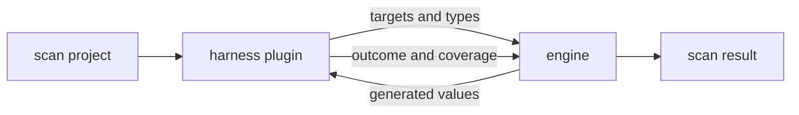

# autofuzz

autofuzz is a universal fuzzer. It discovers the functions, methods, and routes that your code or
service exposes, then calls them with generated inputs to find bugs. It uses coverage to decide what
to try next, and when a call fails, it shrinks the input and writes a report.

Each harness is a plugin that reads one kind of API description. The TypeScript harness reads a
package's declarations; the Python harness reads source files; the OpenAPI harness reads an API
document. The harness tells the engine what it can call and what parameters each call takes. The
engine never needs to know which kind it is.

By separating the fuzzer into a core engine and a plugin system, almost anything can be fuzzed. The
same engine handles ordinary code, and it makes GUI fuzzing, agent and LLM workflows, and virtual
machines possible, where conventional fuzzers struggle.

## Contents

- [Get started](#get-started)
- [Why use it](#why-use-it)
- [How it works](#how-it-works)
- [Recommended harnesses](#recommended-harnesses)
- [What a scan writes](#what-a-scan-writes)
- [MCP server](#mcp-server)
- [Troubleshooting](#troubleshooting)
- [Documentation](#documentation)
- [Contributing](#contributing)
- [Licence](#licence)

## Get started

The commands below use `vendor/ufo`, a copy of the `ufo` package that ships with this repository. If
you have no clone, run `afz init project` in your own project instead of step 3, and replace
`vendor/ufo` with that directory in the commands that follow.

### 1. Install the engine

```sh
curl -fsSL https://raw.githubusercontent.com/DustinEwan/autofuzz/main/install.sh | sh
```

The script supports Linux and macOS. It installs Rust if `cargo` is missing, builds `afz` and
`afz-mcp`, and puts them in `~/.local/bin`. It never uses `sudo`. Set `AFZ_INSTALL_DIR` if you want
another directory.

To build from a clone instead:

```sh
cargo build --release
target/release/afz --help
```

### 2. Install a harness

The engine ships no harness. Install the one that matches your code or service:

```sh
afz install-harness https://github.com/DustinEwan/autofuzz-harness-js-ts.git
```

The command clones the harness, builds it, and runs its conformance tests. It records the plugin only
if the tests pass. The `js-ts` harness needs Node 24 or newer. `afz harnesses` lists what is
installed.

### 3. Point it at a project

A scan project is a directory with an `autofuzz.json` at its root. The file declares the harness, the
files or API to scan, and the budget. This repository has one at `vendor/ufo/autofuzz.json`.

If you have your own project, run:

```sh
afz init project
```

The command asks which harness drives the scan and how much budget to give it, then writes the file.

### 4. See what the harness can reach

```sh
afz probe-plugin --path vendor/ufo
```

```text
plugin        js-ts 0.1.0
command       node /home/dusti/.local/share/autofuzz/harnesses/js-ts/checkout/dist/server.js
protocol      afz/1
target class  design-time
languages     typescript, javascript
capabilities  coverage, stateful, concurrent, reproducer
discovery     static

targets       105
  afz:t:0dd364360549 decode                   (text: composite) constructible
  afz:t:3b95560b04c3 decodePath               (text: scalar) constructible
...
```

The `targets` block lists what the plugin found: functions, methods, and routes. Each line gives
the parameter types and says whether the engine can build values for them. A target that the engine cannot build appears under `skipped`
with the reason. `probe-plugin` runs no invocations, so it costs no budget.

### 5. Run a scan

```sh
afz scan vendor/ufo --budget invocations=50000 --seed 0x5e3a91c4
```

`--budget` sets the stopping point. `--seed` fixes every random choice, so the same seed on the same
tree replays the same calls. The scan prints progress and a summary, then writes its result under
`vendor/ufo/.autofuzz/<scanId>/`.

### 6. Read the result

Open `report.md` first. It has one section per finding: the function or route that broke, the fault, the
smallest input that still reproduces it, and the path of a script that replays the invocation.

Open `scan.json` when you want the same result in a machine-readable form. It holds the inventory,
the execution counts, the coverage, the findings, and the paths of the artifacts.

The example uses a TypeScript package. The same steps work for an HTTP service: install the `openapi`
harness, and configure the scan project with the OpenAPI document and the service address.

## Why use it

Many fuzzers for code ask you to write a target function. You choose which function to call, how to
build its arguments, and what counts as a failure. That work is repetitive, and it changes with every language.

autofuzz moves that work into a harness plugin. The plugin reads the API description and reports the
targets and their parameter types. The engine builds the parameter values, runs the invocations, and
tracks coverage. The plugin also determines what a failure means for the code or service under test. The engine never
needs to know whether a JavaScript exception, an HTTP 500, or a Rust `Err` is a crash or a refusal.

The feedback loop is the other half. An input that reached new behavior is a better starting point
for the next batch than a random value, so the scan goes deeper than a random search. A failing input
is shrunk to the smallest one that reproduces the fault, with a script you can run.

So you can fuzz a library or an HTTP service without a hand-written target function. If your language
or service has no harness, you can write one without changing the engine.

## How it works



1. **Discovery.** The plugin lists each function, method, or route that it can reach, with the
   parameter types and, for code, the source locations where it raises. It also lists the ones that
   it cannot reach, with a reason.
2. **Generation.** The engine builds a value tree for each parameter from the type that the plugin
   reported. A number with bounds, an enum, a recursive object, and an array with a length limit all
   have a shape that the generator understands.
3. **Execution.** The engine sends one invocation to a plugin process and receives one outcome: `ok`,
   `rejected`, or `failed`. The plugin determines which one applies.
4. **Feedback.** When the plugin reports coverage, the engine keeps an input that reaches an edge no
   earlier input reached. It plans later inputs from the corpus that this rule builds.
5. **Minimization and output.** A failing input is shrunk by repeated calls until no smaller input
   reproduces the same fault. The engine writes the scan result, the minimized input, and a
   reproducer script when the harness can render one.

## Recommended harnesses

These are the harnesses we recommend. The table lists the language or target, the harness repository,
and what the harness reads.

| Language or target | Harness | What it reads |
| --- | --- | --- |
| TypeScript | [`autofuzz-harness-js-ts`](https://github.com/DustinEwan/autofuzz-harness-js-ts) | package declarations |
| JavaScript | [`autofuzz-harness-js-ts`](https://github.com/DustinEwan/autofuzz-harness-js-ts) | package declarations |
| Python | [`autofuzz-harness-python`](https://github.com/DustinEwan/autofuzz-harness-python) | source files |
| WebAssembly | [`autofuzz-harness-wasm`](https://github.com/DustinEwan/autofuzz-harness-wasm) | module exports |
| OpenAPI 3 | [`autofuzz-harness-openapi`](https://github.com/DustinEwan/autofuzz-harness-openapi) | an API document |
| Starter | [`autofuzz-harness-starter`](https://github.com/DustinEwan/autofuzz-harness-starter) | the scaffold you edit |

You can use another harness. Point a scan project at its plugin with `harness.command`, or install it
with `afz install-harness` so a scan project can use the name.

## What a scan writes

A scan writes one directory per run at `<output.dir>/<scanId>/`. `output.dir` defaults to
`.autofuzz` under the scan project root.

| Path | Contents |
| --- | --- |
| `report.md` | The human-readable report. One section per finding, with its severity, its minimized input, and the path of its reproducer. |
| `scan.json` | The machine-readable result. It validates against [`docs/schema/afz-1/scan-result.json`](docs/schema/afz-1/scan-result.json). The engine writes it last. |
| `inputs/` | The input that produced each finding, and the minimized input when the scan shrank it. |
| `repros/` | One standalone script per finding, with the name `afz-f-<id>.<extension>`. |
| `corpus/` | The inputs that the scan kept. `--resume` loads them again. |
| `coverage.json` | The coverage map, when the plugin reports one. |
| `engine.log` | Per-worker and per-target accounting. |
| `../seen.json` | The finding identities that this project has already reported. |

[`docs/cli.md`](docs/cli.md) describes every file and every configuration key.

## MCP server

`afz-mcp` speaks the Model Context Protocol on stdio. An agent in Claude Code, Cursor, VS Code
Copilot, Zed, or Codex CLI can probe a directory, run a scan, and read findings without a shell.

```json
{"mcpServers": {"autofuzz": {"command": "afz-mcp"}}}
```

The tools are listed in [`docs/cli.md`](docs/cli.md#mcp-server).

## Troubleshooting

| Symptom | What it means | What to do |
| --- | --- | --- |
| `afz scan` cannot find `autofuzz.json` | There is no scan project above the path. | Run `afz init project`, or pass `--config <path>`. |
| `probe-plugin` prints the fake plugin's targets | There is no scan project and you did not pass `--command`. | Create the project, or point `--path` at one. |
| A function or route appears under `skipped` | The engine cannot build its arguments. | Read the blocking type and field. Write a constructor for that type, or scan a target the harness can build. |
| The harness reports the service is not ready | The service is down or unreachable. | Start it, or fix the address in `harness.options`. |
| The scan finds nothing | The budget is too small, coverage is absent, or targets were skipped. | Increase `--budget invocations` and check the skipped list. |
| You are on Windows | The engine and installer target Linux and macOS. | Use WSL or a Linux machine. |

## Documentation

- [`docs/cli.md`](docs/cli.md): commands, flags, the scan project file, git scoping, output files,
  and the MCP tools.
- [`docs/architecture.md`](docs/architecture.md): how a scan works, and what the engine does not do.
- [`docs/harness-authoring.md`](docs/harness-authoring.md): how to write a harness plugin.
- [`docs/harnesses.md`](docs/harnesses.md): the capabilities and gaps of each recommended harness.
- [`docs/domains.md`](docs/domains.md): design notes on targets beyond source code. This is not a
  roadmap.
- [`docs/decisions/`](docs/decisions/): dated design records.
- [`docs/dogfood/ufo.md`](docs/dogfood/ufo.md) and [`docs/examples/yaml.md`](docs/examples/yaml.md):
  scans of real packages, with a verdict on each finding.

## Contributing

The repository layout, the commands to run before you push, and the generated schema rule are in
[`CONTRIBUTING.md`](CONTRIBUTING.md).

## Licence

MIT. See [LICENSE](LICENSE).
