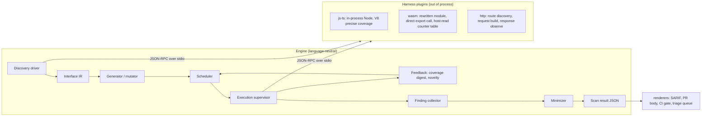

# autofuzz — architecture design

Status: v1 design, accepted 2026-11-11.

## Context

autofuzz is a new product that fuzz-tests software automatically across languages. The engine is written by us, not assembled from existing fuzzers. Support starts with TypeScript/JavaScript and generalizes to other languages and runtimes. The engine discovers interfaces, generates inputs, executes targets, uses feedback to steer generation, and emits a machine-readable scan result that other tools turn into deliverables.

## The problem in one paragraph

Nothing about fuzzing is language-neutral except the loop. Discovery needs the language's type system. Execution needs the language's runtime. Coverage needs the language's compiler or VM. So the design question is where to cut, and the answer is: the engine owns the loop and the data; a harness plugin owns everything that touches a specific language or runtime.

## Two target classes

Design-time and runtime targets differ in discovery, invocation, feedback, and risk. They share the loop, the finding model, and the scan result.

| | Design-time target | Runtime target |
|---|---|---|
| What it is | A public function, method, or exported symbol in source or a compiled artifact | A boundary a live process exposes: HTTP route, RPC method, CLI command, message-queue consumer |
| Discovery | Declaration analysis over source, declarations, or module exports | Route table extraction from source or framework metadata, an OpenAPI/proto document, or a running application |
| Invocation | Call the symbol in a process we control | Send a request to a process the user runs |
| Input shape | Typed argument list plus constructed receiver state | Method, path, headers, query, body, auth context |
| Coverage feedback | Available whenever the runtime exposes it | Available only if the target process is instrumented; usually absent |
| Failure signal | Thrown exception, rejection, hang, memory growth, process exit | Status code class, latency, crash of the serving process, contract violation |
| Side effects | None by default; the process dies with the run | Real. Mutating operations can destroy user data |
| Concurrency | We control worker count | We must respect rate limits and target capacity |

Consequence for the engine: coverage feedback is a **capability a plugin declares**, not a requirement the engine imposes. A runtime target with no feedback still fuzzes; the scheduler falls back to schema-directed generation plus novelty by response shape.

## Scan project

A scan project is the unit of configuration and the unit of one scan. It lives in `autofuzz.json` at the target project root, and `autofuzz scan` finds it without arguments. `--config <path>` selects a different file.

```jsonc
{
  "project": "billing-service",
  "codebase": {
    "harness": "js-ts",
    "root": ".",
    "include": ["src/**/*.ts"],
    "exclude": ["**/*.test.ts"],
    "fixtures": { "module": "./autofuzz.fixtures.ts" }
  },
  "runtime": { "baseUrl": "http://127.0.0.1:3000", "openapi": "./openapi.json" },
  "oracles": { "deadline": { "ms": 2000 } },
  "budget": { "invocations": 200000, "wallClockMs": 900000, "workers": 8 },
  "output": { "dir": ".autofuzz", "renderers": ["json", "markdown"] }
}
```

- `codebase` and `runtime` are both optional and at least one must be present. `codebase` names a design-time target, which means "look at this code and fuzz its public boundaries". `runtime` names a runtime target, which means an environment, a service to stand up, and an API definition to fuzz against.
- A scan run names exactly one block: `autofuzz scan codebase` or `autofuzz scan runtime`. One scan uses one harness and writes one scan result document, which is why that document carries a single `harness` object.
- `runtime` is reserved. The block parses and validates, and `autofuzz scan runtime` exits with `runtime targets are not implemented` until that design lands. The runtime column and rows elsewhere in this document describe that later increment.
- `budget` bounds a scan. A scan stopped by budget still writes a complete scan result with `stoppedReason: "budget"`.

## Shape



## Plugin transport

Plugins run out of process and speak JSON-RPC over stdio, one process per plugin instance, the same transport model as LSP and DAP. Three reasons: a plugin written in Rust, Python, or Node is equally valid; a target that hangs or corrupts memory kills the plugin process and not the engine; and the engine can run N plugin instances in parallel without a language-specific threading story.

In-process plugins are not supported. A single C-level fault in a plugin would take down the scan, and the transport cost of stdio is irrelevant next to the cost of one target invocation.

## Plugin capabilities

A plugin declares what it can do at handshake. The engine adapts instead of assuming.

| Capability | Meaning | Absent behavior |
|---|---|---|
| `coverage` | Per-invocation coverage digest is available | Scheduler uses schema-directed generation and response/outcome novelty only |
| `stateful` | Plugin can build receiver state (instances, clients, fixtures) | Only entry points with fully constructible parameter graphs are fuzzed |
| `minimize` | Plugin can shrink an input in target terms | Engine minimizes by removing arguments and reducing structure only |
| `sideEffects` | Invocations may change external state | Engine applies the side-effect policy below |
| `concurrent` | Plugin tolerates parallel instances | Engine runs one instance |

## Harness plugin contract

Defined in TypeScript for readability; the wire form is the same shape as JSON. Versioned: every request carries `protocolVersion`.

```ts
export interface HarnessPlugin {
  handshake(): Promise<{
    protocolVersion: string;          // "afz/1"
    name: string;                     // "autofuzz-harness-js"
    targetClass: "design-time" | "runtime";
    capabilities: Capability[];
    languages: string[];              // ["typescript", "javascript"]
  }>;

  /** Enumerate fuzzable entry points. Must terminate; discovery never executes target code. */
  discover(req: { root: string; include?: string[]; exclude?: string[] }): Promise<{
    targets: TargetDescriptor[];
    skipped: SkippedTarget[];         // every non-fuzzed symbol, with a reason
  }>;

  /** Build the receiver plus arguments for one call, or report why it is impossible. */
  prepare(req: { targetId: string; values: ValueTree[] }):
    Promise<{ ok: true; materialized: MaterializedCall } | { ok: false; reason: SkipReason }>;

  /** One invocation. Never throws over the wire; faults are Outcome values. */
  invoke(req: { invocationId: string; targetId: string; values: ValueTree[];
                deadlineMs: number; collectCoverage: boolean }): Promise<Outcome>;

  /** Optional: shrink a failing input while it still reproduces the same fault class. */
  minimize?(req: { targetId: string; values: ValueTree[]; fault: FaultSignature;
                   budgetMs: number }): Promise<{ values: ValueTree[]; steps: number }>;

  /** Optional: turn a coverage digest into stable edge identifiers. */
  coverageMap?(): Promise<CoverageMap>;
}
```

`discover` must not execute target code. Discovery that imports the user's module runs arbitrary user code inside our process, so JS discovery reads declarations statically, and runtime discovery reads route metadata. A plugin that genuinely needs to import the target to enumerate it declares `discoverRequiresExecution: true`, and the engine then runs that discovery inside the same isolation and deadline it applies to invocations.

## Interface IR

One normalized description of a callable, produced by every plugin.

```ts
export interface TargetDescriptor {
  id: string;                    // stable content hash of module path + symbol + signature
  targetClass: "design-time" | "runtime";
  origin: { file?: string; line?: number; module?: string;
            http?: { method: string; path: string } };
  name: string;                  // "parseConfig", "POST /v1/tokens"
  parameters: Parameter[];
  returns?: TypeNode;
  effects: { async: boolean; throws: boolean; streams: boolean;
             callbacks: boolean; mutatesState: boolean };
  materialization: "constructible" | "fixture-required" | "opaque";
}

export interface Parameter { name: string; type: TypeNode; required: boolean; }
```

`TypeNode` kinds, which are also the generator's vocabulary:

| Kind | Notes |
|---|---|
| `null`, `undefined`, `boolean`, `number`, `bigint`, `string` | `number` carries `int`, `finiteOnly`, `min`, `max` when declared |
| `stringFormat` | `email`, `uuid`, `date-time`, `hostname`, `ipv4`, `uri`, plus plugin-defined formats |
| `literal` | enum members and string unions become literal sets |
| `array`, `set`, `map` | element and key types, declared length bounds |
| `object` | named fields, each with `required`; recursive references allowed via `ref` |
| `tuple` | positional, fixed |
| `union`, `intersection` | discriminant-aware generation when a literal discriminant exists |
| `buffer` | `Uint8Array`, `ArrayBuffer`, byte length bounds |
| `promise` | marks async effect; the harness awaits with the invocation deadline |
| `function` | generated as a callable stub whose behavior is configurable: return-first, throw, capture-arguments |
| `stream`, `iterable` | generated as an in-memory source with a bounded item count |
| `opaque` | class instance, DOM node, socket, or any type the plugin cannot build; drives `materialization` to `fixture-required` or `opaque` |
| `ref` | named recursive reference; generation enforces a depth budget and terminates recursion |

`materialization` is the honest accounting of what the tool can actually reach. `constructible` means the whole parameter graph is buildable from generated values. `fixture-required` means a user-supplied fixture can fill the gap. `opaque` means the entry point is unreachable without a live system. The inventory reports all three counts, so a scan that only reached 5 percent of an API says so.

## Feedback and scheduling

Coverage is a capability. When `coverage` is present, every invocation returns a digest: a sorted list of stable edge identifiers touched. The engine keeps a corpus and retains an input when it produces an edge set the corpus has not produced. Scheduling weights corpus entries by new-edge yield and by time since last selection, so unexplored entries are revisited. This is the same novelty rule that makes AFL++ effective, applied to structured inputs instead of bytes.

When `coverage` is absent, novelty is computed from the observable outcome tuple: status class or error class, response shape, latency bucket, and whether the target crossed a deadline. The loop is unchanged; only the novelty function differs.

Mutation operates on `ValueTree`, not on bytes. Every node records its type and generation provenance, which is what makes type-aware mutation and later minimization possible across languages. One execution applies a short run of node-level operators, and the set includes a copy from one node of an input to another, because a gate that compares two independently generated fields is otherwise unreachable however long the scan runs: Decision 2.

## Outcome classification

The engine never reasons about exceptions, `Result`, signals, or status codes. Every harness plugin reduces one invocation to exactly one of three outcomes, and every oracle operates on that value alone.

```ts
export type Outcome =
  | { kind: "ok";       durationMs: number; memoryBytes?: number; coverage?: EdgeId[]; value?: ValueTree }
  | { kind: "rejected"; durationMs: number; coverage?: EdgeId[]; via: string; detail: string }
  | { kind: "failed";   durationMs: number; coverage?: EdgeId[]; via: string; fault: FaultSignature };
```

`rejected` means the target examined the input, decided it was not acceptable, and said so through the channel its own signature declares. `failed` means the target tried to accept the input and broke. `via` records which rule produced the classification, so a triager can audit the decision and a user can override it.

Which channel is declared is language knowledge, and it stays inside the plugin.

| Language or boundary | `rejected` by default | `failed` by default |
|---|---|---|
| TypeScript / JavaScript | `throw` at a source location the target wrote, which discovery records as a guard site; error classes the user lists | engine-raised `TypeError`, `RangeError`, or `URIError` at any other location; worker exit; unhandled rejection |
| Rust | `Err(e)` returned from `Result`, `None` returned from `Option` | `panic!`, `unwrap` or `expect` on an `Err`, index out of bounds, divide by zero, `unreachable!`, `assert!`, `SIGSEGV`, `SIGABRT` |
| Go | returned non-nil `error` | `panic`, write to a nil map, index out of range, race detector report |
| Java / Kotlin | an exception type listed in the method's `throws` clause | unchecked `RuntimeException` or `Error`, JVM assertion, out-of-memory |
| C / C++ | nonzero or negative return code, `errno`, `std::error_code` | signal delivery, ASan or UBSan report, `assert`, `std::terminate` |
| Python | exception types named by annotation or docstring | `TypeError`, `AttributeError`, `IndexError`, any raise outside a declared type |

Rust shows why the rule cannot be "did it throw". `Err(PriceError::UnknownCurrency)` is an ordinary return value, so the rejection channel carries no exception at all, and the crash channel is a panic. The TypeScript case and the Rust case are one decision in two machineries: the guard on line 5 of the currency example is `rejected` in both, and an unguarded dereference is `failed` in both.

Two consequences for the wasm harness. A Rust panic or a wasm trap ends the instance, so the harness re-instantiates after any `failed` outcome and reports that invocation's coverage before discarding the instance. Rust checks integer overflow only when `overflow-checks = true`, which is the default in debug profiles and off in release, so the fuzz build enables it or an entire bug class reports as `ok`.

Oracle configuration sits one level above and never names language mechanics.

```jsonc
"oracles": {
  "failed":       { "severity": "high" },
  "rejected":     { "severity": "off" },
  "deadline":     { "ms": 2000, "severity": "medium" },
  "memoryGrowth": { "mb": 256, "severity": "medium" },
  "processExit":  { "severity": "high" },
  "differential": { "against": "v1.4.0", "severity": "high" },
  "overrides":    [{ "target": "afz:t:44be", "via": "result-err", "treatAs": "failed" }]
}
```

`overrides` is the escape hatch for a target whose declared channel is documented as internal-failure-only, where an `Err` really is a bug.

## Unreachable entry points

`fixture-required` and `opaque` are reported rather than dropped, and that report is the whole mechanism in the first increment. No fixture format, fixture loading, or fixture validation exists yet.

```json
{ "targetId": "afz:t:9c1f", "name": "UserRepo.findById",
  "reason": "unconstructible-parameter",
  "blockedBy": { "type": "Db", "module": "src/db.ts", "path": "receiver.db" },
  "unlocksTargets": 14 }
```

`blockedBy` names the blocking type and where it sits, and `unlocksTargets` counts the entry points that share it, which turns one missing type into one ranked task. That record is deliberately complete enough for a coding agent to act on later: write a constructor for `Db`, and 14 entry points become fuzzable.

## Side-effect policy for runtime targets

A runtime target can destroy data, so the engine defaults to refusing harm rather than trusting the user to configure it away. This policy belongs to the reserved `runtime` block and is not implemented in the first increment.

- Only methods whose declared effect is non-mutating are invoked by default: `GET`, `HEAD`, `OPTIONS`, and RPC methods marked read-only.
- A mutating method requires an explicit `allowMutating: true` entry naming that method, and a `destructive: true` marker on methods that delete or spend money.
- Every runtime target run requires a `baseUrl` matching a host the user named in configuration. Requests to any other host are refused before send.
- Concurrency and rate are capped per target in configuration, default 1 concurrent request and 20 requests per second.

## Scan result

One JSON document per scan, written once, never edited in place. Renderers read it.

```json
{
  "schemaVersion": "afz-scan/1",
  "scanId": "01J8ZQ3M7K",
  "startedAt": "2026-11-11T09:14:02.481Z",
  "finishedAt": "2026-11-11T09:41:55.017Z",
  "engine": { "version": "0.1.0", "seed": "0x5e3a91c4", "configHash": "sha256:..." },
  "target": {
    "root": "/src/example",
    "revision": "git:8f2c1ab",
    "harness": { "name": "autofuzz-harness-js", "version": "0.1.0",
                 "targetClass": "design-time", "capabilities": ["coverage", "stateful"] }
  },
  "inventory": {
    "discovered": 412, "fuzzable": 287,
    "skipped": [{ "targetId": "afz:t:9c1f", "name": "UserRepo.findById",
                  "reason": "unconstructible-parameter",
                  "blockedBy": { "type": "Db", "module": "src/db.ts", "path": "receiver.db" },
                  "unlocksTargets": 14 }],
    "materializationCounts": { "constructible": 287, "fixture-required": 61, "opaque": 64 }
  },
  "execution": { "invocations": 184320, "corpusSize": 1204, "coverageEdges": 8312,
                 "coverageRatio": 0.41, "deadlineExceeded": 3, "deadlineCuts": 41,
                 "samples": [{ "invocations": 5000, "coverageEdges": 1140, "coverageRatio": 0.056 },
                             { "invocations": 10000, "coverageEdges": 2011, "coverageRatio": 0.099 }] },
  "findings": [{
    "findingId": "afz:f:7a41c2e0",
    "identity": "sha256:...",
    "targetId": "afz:t:44be",
    "oracle": "failed",
    "via": "engine-error-outside-declared-channel",
    "fault": { "class": "TypeError", "message": "Cannot read properties of undefined (reading 'map')",
               "frames": [{ "file": "src/config.ts", "line": 88, "column": 19, "fn": "normalize" }] },
    "input": { "encoding": "value-tree+json", "artifact": "inputs/afz-f-7a41c2e0.json" },
    "minimizedInput": { "artifact": "inputs/afz-f-7a41c2e0.min.json", "bytesBefore": 1842, "bytesAfter": 96 },
    "reproducer": { "artifact": "repros/afz-f-7a41c2e0.ts" },
    "firstSeenInvocation": 91207, "reproduced": true
  }],
  "artifacts": { "corpus": "corpus/", "coverage": "coverage.json", "log": "engine.log" }
}
```

`finding.identity` is a hash over target id, fault class, and the top fault frame, not over the input. That is what makes the same bug the same finding across scans, which a triage queue and a PR bot both need. Inputs and stacks live in content-addressed files beside the document; the document stays small enough to load whole.

## Determinism

One 32-bit seed per scan drives every random choice: corpus selection, mutation, and value generation. A scan result records the seed, the config hash, the target revision, and the plugin version. Replaying `autofuzz run --seed <seed> --corpus <corpus>` with the same inputs reproduces the same invocation sequence. Every plugin invocation carries an `invocationId` so out-of-order responses from parallel plugins are attributable.

## Language and runtime mapping

| Harness | Discovery | Invocation | Coverage |
|---|---|---|---|
| `js-ts` (design-time, first) | Static declaration analysis. `typescript@7` ships no JavaScript compiler API — its exports map is `./lib/version.cjs` plus `./unstable/*` — so the classic API comes from `@typescript/typescript6@6.0.2`, installed under the `typescript` alias | Node worker thread calls the symbol; `Profiler.takePreciseCoverage` over `node:inspector`, which is exposed in worker threads since Node 18.10.0 | Yes, per invocation |
| `wasm` (design-time, generalization proof) | Exported functions of a core wasm module; the engine materializes arguments from the same IR and the plugin calls the export directly, so the module's own signature is the only type information involved | one wasmtime instance per worker, in a plugin process per worker as with every other harness | Yes: the harness rewrites the module it is handed - one counter byte per function entry and per structured block head, in a memory of its own that it exports as `__afz_counters`. The guard is `i32.const <edge>; i32.store`, and the table is read back after the call, including after a trap. Compile-time pcguard stays available to a target that wants finer edges: Decision 3 |
| `http` (runtime) | Route table from framework metadata, or an OpenAPI document | fetch against a user-declared base URL, under the side-effect policy | Only if the serving process is instrumented |
| Later: Python, JVM, Go | Same contract, different discovery and coverage probe | | |

`NODE_V8_COVERAGE` is not used: it is inconsistent with worker threads, and that issue is closed as not planned (nodejs/node#46378).

## Environment

The js-ts plugin needs Node 24 or newer and runs with --experimental-vm-modules. The engine needs a stable Rust toolchain, and the wasm harness needs the wasm32-unknown-unknown target to build probe modules. Neither needs a C or C++ toolchain, Binaryen, wasi-sdk, or wasm-opt: coverage instrumentation for wasm is a post-hoc rewrite of a core wasm module using wasmparser and wasm-encoder, both compiled into the engine.

## Implementation language

The engine is Rust. The `js-ts` harness plugin is Node 24 with TypeScript. This split follows from the plugin boundary: because plugins run out of process over stdio, the engine language is free, so it should be chosen for supervision rather than for the target's ecosystem.

Four reasons the engine is Rust rather than Node:

- The engine is a long-lived supervisor over hundreds of thousands of invocations, with tight loops over coverage digests, deterministic replay, and process lifecycle control. Signals, `waitpid`, resource limits, and kill timers are direct in Rust and awkward through Node's child process API.
- The WebAssembly harness wants Rust. Reading the guard table from linear memory, enforcing a deadline with epoch interruption, and recreating an instance after a trap are all first-class wasmtime operations. `wasmparser` 0.263.0 and `wasm-encoder` 0.263.0 cover the instrumentation pass.
- Distribution is one static binary in CI with no runtime and no dependency tree to install.
- The wire contract becomes typed structs. `schemars` 1.2.3 emits the committed JSON Schema from the same types the engine compiles against, so a protocol drift is a compile error rather than a runtime surprise.

The cost is a slower edit-compile loop in the parts that iterate most: generation, mutation, and scheduling policy. Accepted, because those modules are small and pure, and their tests are golden-file comparisons that catch a regression on one `cargo test`.

Pinned dependencies: `clap` 4.6.7 for the CLI, `serde_json` 1.0.154, `schemars` 1.2.3, `rand_chacha` 0.10.0, `wasmparser` and `wasm-encoder` 0.263.0, `wasmtime` 50.0.1. The plugin side pins `@typescript/typescript6@^6.0.2` under the npm alias `typescript`, and `tsx` 4.23.15 as the loader fallback.

Deliberately not used: the `binaryen` crate 0.13.0, because its build needs a C++ toolchain; `wasm-instrument` 0.4.0, whose last release predates the current wasm proposal set; LibAFL, because the engine is ours by requirement, and the two pcguard callbacks we need are about thirty lines rather than a framework dependency.

## Assumptions

These are choices a design review can override.

1. **Plugin transport is out-of-process JSON-RPC over stdio.** Chosen for language neutrality and fault isolation. Overridden only if plugin startup cost proves dominant, in which case an in-process variant is added behind the same contract.
2. **Coverage is a declared capability, not an engine requirement.** Chosen because HTTP runtime targets usually cannot provide it. Overridden if runtime targets are dropped from the product.
3. **`discover` never executes target code unless the plugin declares otherwise.** Chosen because importing a user module runs user code inside our process.
4. **Unreachable entry points are reported, not silently dropped.** Chosen so coverage claims stay honest. Overridden if the product needs a single "API coverage" number without the breakdown.
5. **Runtime targets refuse mutating methods and undeclared hosts by default.** Chosen because a fuzzer that deletes user data ends the product. Overridden per method by explicit configuration.
6. **Scan result is one immutable JSON document plus content-addressed artifacts, with `finding.identity` stable across scans.** Chosen so triage and PR tooling can key on identity.
7. **The three-outcome classification is owned by the plugin, and the engine sees only `ok`, `rejected`, and `failed`.** Chosen because Rust rejects through a return value and C rejects through a return code, so no engine-level rule can name a rejection. Overridden only by pushing per-language knowledge into the engine, which breaks the plugin boundary.

## Defaults and reserved surface

- Enabled oracles by default: `failed` at `high`, `deadline` at `ms: 2000` and `medium`, `memoryGrowth` at `mb: 256` and `medium`, `processExit` at `high`. `rejected` is off by default and can be turned on per target for auditing.
- `differential` and any property-assertion oracle are not implemented in v1. A scan project that names one fails configuration validation with `oracle "<name>" is not implemented in this version`, rather than being silently ignored.
- `memoryBytes` on an `Outcome` is reported by the plugin, not measured by the engine. The `js-ts` plugin reports the `heapUsed` delta around the call; the wasm harness reports the guest memory high-water mark. Engine-side process sampling would add a platform-specific dependency for a number the plugin already knows.
- The `runtime` target class is reserved. Its configuration block validates, and `afz scan runtime` exits with `runtime targets are not implemented`. The side-effect policy above is the shape of that later design.

